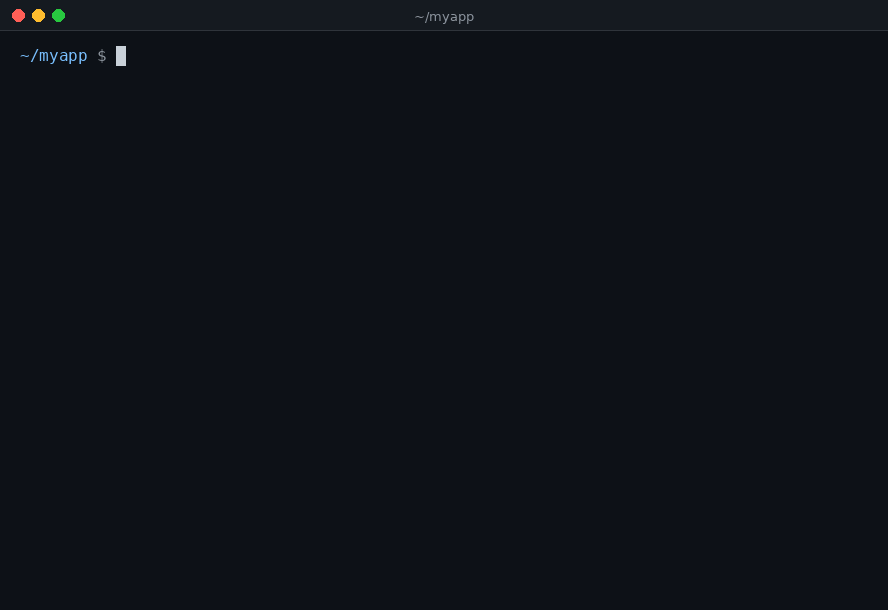

# secretwall

[](https://github.com/verozhao/secretwall/actions/workflows/ci.yml)
[](https://pypi.org/project/secretwall/)
[](https://pypi.org/project/secretwall/)
[](https://github.com/verozhao/secretwall/blob/master/LICENSE)

**Keep AI coding agents away from your `.env` files and keys.**

AI coding agents read files and run shell commands in your project. If an agent runs
`cat .env`, your keys are sent to the AI model and saved in chat logs on your computer.

secretwall adds a hook to Claude Code, Codex, Copilot CLI, Cursor, Gemini CLI and Windsurf.
Before the agent reads a file or runs a command, the hook checks it and blocks anything
that would show a secret.



*`secretwall check` shows what the hook decides. Your agents get the same answer on their own, every time.*

## Install

```sh
pipx install secretwall
```

Or `uv tool install secretwall`. Or run it once without installing: `uvx secretwall init`.

It needs Python 3.9 or newer and nothing else.

## Quick start

```sh
cd your-project
secretwall init      # find secret files and set up your AI agents
secretwall doctor    # test that the blocking really works
```

Then commit `.secretwall/` and the agent settings files, so everyone on the project is protected.

## What it blocks

| When an agent tries to...         | For example                                                                  |
|-----------------------------------|------------------------------------------------------------------------------|
| read a secret file                | its file tool on `.env`, `cat .env`, `less certs/server.key`, `base64 < .env` |
| search through secret files       | `grep -r API_KEY .`, `rg --hidden --no-ignore KEY`, `find . -name .env -exec cat {} \;` |
| print all environment variables   | `env`, `printenv`, `cat /proc/self/environ`                                  |
| print a secret variable           | `echo $OPENAI_API_KEY`                                                       |
| run a tool that prints credentials | `gh auth token`, `aws configure get`, `docker compose config`, `kubectl get secret -o yaml` |
| read a secret from git            | `git show HEAD:.env`                                                         |
| read it with a one-line script    | `python -c "print(open('.env').read())"`, `node -e "..."`                    |
| overwrite a secret file           | its edit tool on `.env`, `echo x > .env`                                     |
| commit a secret file              | `git add .` while `.env` is not in `.gitignore`                              |

Secret files are `.env` files, private keys (`*.pem`, `*.key`, `id_rsa`, ...), credential
files (`credentials.json`, `service-account*.json`, `*.tfvars`, `.netrc`, ...) and the ones in
your home folder (`~/.ssh`, `~/.aws/credentials`, gcloud, GitHub CLI and AI agent logins).
`secretwall init` also protects config files where it finds a key (like a `settings.yml` with
an API key in it), and warns you about keys written into your code.

What still works:

- `.env.example` and other template files stay readable.
- Your app can still use its secrets: `npm start`, `python app.py`, `docker compose up`,
  or `set -a; source .env; set +a; npm test`.
- Searches that can't match a secret still run, like `grep -r TODO .`.

## Agents

| Agent                | What secretwall sets up | Files                                    |
|----------------------|-------------------------|------------------------------------------|
| Claude Code          | hook + deny rules       | `.claude/settings.json`                  |
| Codex CLI            | hook                    | `.codex/hooks.json`                      |
| GitHub Copilot CLI   | hook                    | `.github/hooks/secretwall.json`          |
| Cursor               | hooks + ignore file     | `.cursor/hooks.json`, `.cursorignore`    |
| Gemini CLI           | hook + ignore file      | `.gemini/settings.json`, `.geminiignore` |
| Windsurf             | hooks + ignore file     | `.windsurf/hooks.json`, `.codeiumignore` |
| JetBrains AI / Junie | ignore file             | `.aiignore`                              |
| Aider                | ignore file             | `.aiderignore`                           |
| Cline                | ignore file             | `.clineignore`                           |
| Roo Code             | ignore file             | `.rooignore`                             |

- `secretwall init` sets up the agents it finds on your computer or in the project.
  Use `--all` for every agent, or pick them: `--agents claude,cursor`.
- It adds to your settings files and keeps everything you wrote there.
  `secretwall remove` takes out only what it added.
- Codex asks you to approve the hook once: run `/hooks` in Codex.
  Gemini CLI asks you once to trust the project's hooks.
- Agents with only an ignore file get no hook, so secretwall can't check their shell commands.

## Why not just ignore files or deny rules?

They only cover part of the problem:

- [Cursor's docs](https://cursor.com/docs/reference/ignore-file) say `.cursorignore` can't block
  access through the agent's terminal or MCP tools.
- [Claude Code's docs](https://code.claude.com/docs/en/permissions) say its `Read` deny rules
  don't cover a command like `grep -r pattern .`, or code that opens files itself.
- No ignore file can stop `printenv` or `gh auth token`.

The secretwall hook reads every shell command before it runs, so it also blocks `cat .env` in
Cursor's terminal, `grep -r`, one-line scripts like `python -c`, `printenv` and `gh auth token`.
It writes the ignore files and deny rules too, so you get both.

## Has an agent already seen your keys?

```sh
secretwall leaks
```

This looks for the secret values from your project in the chat logs that AI agents keep on
your computer (Claude Code, Codex CLI, Gemini CLI, Copilot CLI, Cursor, VS Code, Windsurf
and Aider). Everything stays on your computer, and secret values are never printed.

If it finds a key, replace it at the service that issued it. Deleting the logs is not enough:
the agent already sent the key to the AI model.

## Commands

| Command                       | What it does                                                         |
|-------------------------------|----------------------------------------------------------------------|
| `secretwall init`             | find secret files and set up your AI agents                          |
| `secretwall doctor`           | run each agent's real hook in a test folder and report what works    |
| `secretwall check TARGET`     | would this file or command be blocked? Use `-c` for one-word commands like `printenv` |
| `secretwall leaks`            | look for your secrets in AI agents' chat logs                        |
| `secretwall remove`           | take secretwall out of your agents' settings (`--purge` also deletes `.secretwall/`) |

Useful `init` options: `--dry-run` shows what would change, `--sandbox` also adds the
secret files to Claude Code's sandbox settings, and `--no-scan` skips looking inside files.

## Settings

`.secretwall/rules` lists the files to protect, in `.gitignore` style. Add a line to protect
more, or start a line with `!` to allow a file. After you edit it, run `secretwall init`
again so the ignore files match.

`.secretwall/config.json` turns checks on or off:

| Setting                 | What it blocks                                                    |
|-------------------------|-------------------------------------------------------------------|
| `protect_home`          | secret files in your home folder (`~/.ssh`, `~/.aws`, ...)        |
| `block_env_dump`        | `env`, `printenv` and other ways to print every variable          |
| `block_secret_vars`     | printing a variable with a secret name, like `echo $API_KEY`      |
| `block_secret_commands` | `gh auth token` and other commands that print credentials         |
| `block_git_add`         | staging secret files that are not in `.gitignore`                 |
| `log`                   | nothing: it writes the time, agent and reason of each block to `.secretwall/blocked.log` |

## How it works

`secretwall init` copies one Python file, `.secretwall/hook.py`, into your project and adds
it to each agent's project settings. The agent runs the hook before each file read or shell
command. The hook looks inside pipes, `&&`, `$(...)`, `bash -c`, `eval`, `find -exec` and
heredocs, and checks every file each part would read.

When it blocks something, the agent gets a short reason and a safe way to do the task, for
example: load the variables with `source` instead of printing them.

A check takes well under a tenth of a second. If Python is missing or the hook hits a bug,
it lets the action run rather than break your agent. `secretwall doctor` tells you when a
hook doesn't work.

## Limits

secretwall stops the common ways an agent reads secrets. It is not a sandbox: a tricky
command can still get through, for example a script file that opens `.env` itself. For a
hard wall, also use your agent's sandbox. In Claude Code, run `secretwall init --sandbox`
and then turn the sandbox on with `/sandbox`.

Windows is untested.

Found a command that gets through? Please open an issue.

## License

MIT
